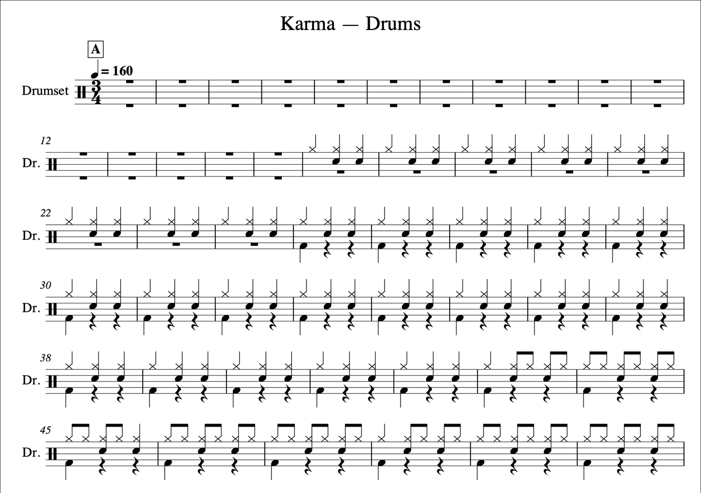
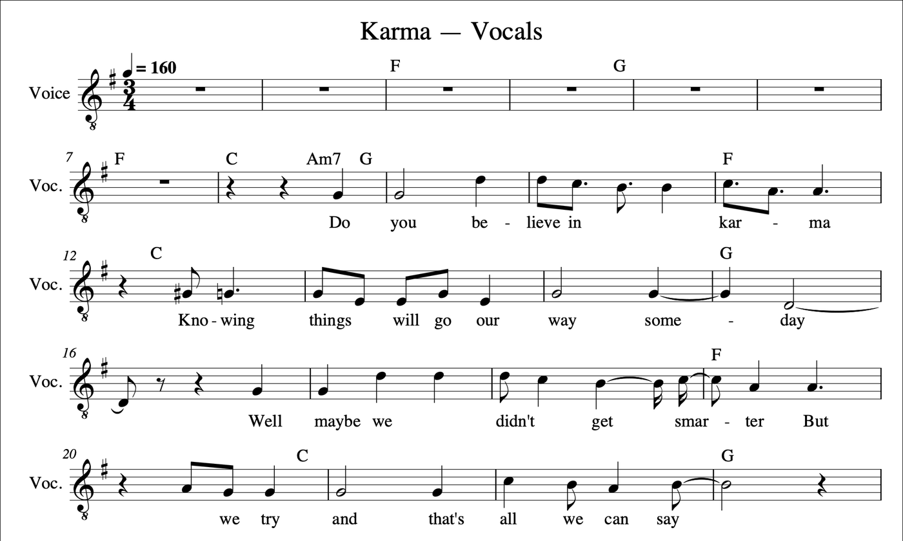

[English](README.md) · [한국어](README.ko.md) · [中文](README.zh-cn.md)

# song-to-sheet-music

This service turns a song into sheet music: a part for each instrument it can hear — drums, bass, guitar (notes, and a rhythm chart), piano, and the sung melody with its lyrics — written on one shared bar grid, key and chord track, as MusicXML, MIDI and PDF. Give it a YouTube link or a recording on disk.

We chained seven open models with model-compose — a six-stem separator, a drum-piece separator, a beat tracker, three transcribers and a chord recognizer — and ran the whole pipeline on an NVIDIA DGX Spark, an RTX 4090 and an 8 GB MacBook Air M1. We asked whether it runs on each, how long a song takes, and how close the parts come to published ones. For that we scored the parts of 34 pop and rock songs against their commercially published part transcriptions, bar by bar, with no hand judging; those published parts were written down by ear and carry their own errors, so read every number as agreement, not accuracy. A drummer and a guitarist read excerpts of the parts and told us what a player would not accept; their notes shaped the notation rules in Section 3.


Demo: a recording on disk run through the web UI (gradio) on an RTX 4090 with the lyrics on the GPU, and each part's first page coming back. The 45 seconds the song took are cut out; the rest is real time.

## Contents

- [Models](#models)
- [Quick start](#quick-start)
- [Summary](#summary)
- [1 Setup](#1-setup)
- [2 Does it run on my hardware?](#2-does-it-run-on-my-hardware)
- [3 Results by part](#3-results-by-part)
  - [3.1 Beats, bars, key and chords](#31-beats-bars-key-and-chords)
  - [3.2 Drums](#32-drums)
  - [3.3 Bass](#33-bass)
  - [3.4 Guitar](#34-guitar)
  - [3.5 Piano](#35-piano)
  - [3.6 Vocals and lyrics](#36-vocals-and-lyrics)
- [4 Recommendations](#4-recommendations)
- [5 Limits and what we did not measure](#5-limits-and-what-we-did-not-measure)
- [Reference](#reference)
- [Changes](#changes)
- [License](#license)

## Models

| Stage | Model | Weights | Runs on |
|---|---|---|---|
| Six stems (bass, drums, other, vocals, guitar, piano) | BS-Roformer-SW, a band-split RoFormer trained by jarredou | 700 MB | GPU or CPU |
| Drum pieces (kick, snare, toms, hi-hat, ride, crash) | MDX23C DrumSep by aufr33 and jarredou | 438 MB | GPU or CPU |
| Beats and bars | [Beat This!](https://github.com/CPJKU/beat_this) (`final0`) | 77 MB | GPU or CPU |
| Piano notes | [piano-transcription](https://github.com/qiuqiangkong/piano_transcription_inference) (Kong et al.) | 165 MB | GPU or CPU |
| Bass and guitar notes | [basic-pitch](https://github.com/spotify/basic-pitch) (Spotify), its ONNX model | in the package | CPU |
| Sung notes | [GAME](https://github.com/openvpi/GAME) small, a singing transcriber (openvpi), ONNX | 46 MB | CPU |
| Chords, sevenths included | [BTC](https://github.com/jayg996/BTC-ISMIR19), a chord transformer (Park et al., ISMIR 2019) | 34 MB | GPU or CPU |
| Lyrics | Whisper large-v3-turbo, the CTranslate2 conversion, through faster-whisper | 1.6 GB | CPU (GPU on x86 Linux) |

The key is estimated from the mix, the parts are engraved with music21 and rendered with Verovio. Every weight downloads on the first run; none is in this repository.

## Quick start

It needs [model-compose](https://github.com/hanyeol/model-compose) 0.4.117 or later in a Python 3.10+ virtual environment (we used 3.13), plus FFmpeg, a JavaScript runtime for yt-dlp (Node.js, Deno or Bun — without one some YouTube videos fail with HTTP 403), and the Cairo library for the PNG pages (`brew install cairo` on macOS, `sudo apt install libcairo2` on Debian and Ubuntu). A GPU is strongly recommended: a 3-minute song takes about a minute on an RTX 4090 and 25 minutes on an 8 GB M1 ([Section 2](#2-does-it-run-on-my-hardware)).

Install with [uv](https://docs.astral.sh/uv/) or pip, in the virtual environment you will run from — several steps run `python` from your `PATH`, so it has to be the environment's:

```bash
uv pip install model-compose      # or: pip install model-compose
```

Clone this repository:

```bash
git clone https://github.com/MindrLabs/song-to-sheet-music
cd song-to-sheet-music
```

Run it:

```bash
DEVICE=cuda model-compose up        # leave DEVICE out on a machine without an NVIDIA GPU
```

The first start installs every component's packages — PyTorch, bs-roformer, music21, Verovio and the rest, 2 to 8 GB depending on the CUDA libraries — and takes from one to several minutes. The components install at the same time, and in a new environment the first start can stop with an `ImportError` or a pip error when one component imports a package another is still replacing. Run `model-compose up` again; the installs are done by then, and it starts in seconds. Each of our three machines needed more than one start (Table 3). If the same `No module named …` comes back on every start, see Troubleshooting.

The web UI opens at `http://localhost:8081` and the HTTP API at `http://localhost:8080/api`; copy `.env.sample` to `.env` to change `PORT`, `SERVER_PORT` or `DEVICE`. Paste a YouTube link into "Song to Sheet Music", give the song a title, and run it. Stop the service with Ctrl+C, or with `model-compose down` from another shell in this directory.

Example request:

```bash
curl -X POST http://localhost:8080/api/workflows/runs \
  -H "Content-Type: application/json" \
  -d '{"workflow_id": "full", "input": {"url": "https://youtu.be/<video-id>", "title": "My Song"}}'
```

`"audio": "/path/to/song.wav"` in place of `url` takes a recording on disk, in any format FFmpeg reads. `"parts": "drums,bass"` writes those parts only and skips the others' stages — on a CPU that is the difference between 25 minutes and a few. The same input works on the command line once `up` has installed the packages: `model-compose run full --input '{...}'`.

| On the first run | What happens |
| :---: | --- |
| Weights | About 3.1 GB download into the usual Hugging Face and PyTorch caches: Whisper 1.6 GB, BS-Roformer-SW 700 MB, DrumSep 438 MB, piano-transcription 165 MB (into `~/.cache/models`), Beat This! 77 MB, GAME 46 MB (into `~/.cache/game-onnx`), BTC 34 MB (into `~/.cache/btc-chords`) |
| Output | Everything lands in `./output`: the song as FLAC, the stems, `tempo.json`, `key.json`, `chords.json`, and for each part its MusicXML, MIDI, PDF and page images. One song at a time: the next run overwrites it |

The MusicXML opens in MuseScore as the instrument it is written for — the bass part sounds an octave below where it is written, as bass parts do, the tablature staves open as tablature, and the drum part opens as MuseScore's drum set with every hit on its own sound.

Only process recordings you have the right to use.

## Summary

Every timing below is one song on each device, run twice, the second run reported; every agreement number is a median over the songs a part could be compared on.

1. A 3-minute song takes 57 s on an RTX 4090 with the lyrics on the GPU (1 min 48 s with them on the CPU, the default), 2.5 min on a DGX Spark and 24 min on an 8 GB M1 MacBook Air, most of it stem separation ([Section 2](#2-does-it-run-on-my-hardware)).
2. The three machines wrote the same bar grid, key, chords and drum strokes; the pitched parts differ by a few notes from machine to machine, the piano by about one note in twenty, and the M1's lyrics by about a third of the words ([2](#2-does-it-run-on-my-hardware)).
3. Against commercially published parts of 34 songs the chord roots agree on 0.80 of each song's duration, the drum kick and snare on an F-measure of 0.94 and 0.84, the bass notes on recall 0.76 and precision 0.78, the sung melody on 0.71 of the notes, and the lyrics on 0.48 of the syllables ([Table 2](#summary)).
4. The guitar part is the weakest: on strummed, distorted guitar the note part reaches an F of 0.41 against the published rhythm slashes, where the rhythm chart reaches 0.93 — read the chart there ([3.4](#34-guitar)).
5. The piano part writes two to three times the notes a published keyboard part does, because it writes what it hears; its exact-note recall against those parts is 0.42 for the right hand and 0.55 for the left ([3.5](#35-piano)).
6. Six rules turned raw MIDI into parts a player accepted: one bar grid for every part, a drum part in two voices with rehearsal marks at the song's sections, bass octaves checked against the stem's own spectrum, repeated notes split where the stem's level steps up, playable tablature, and a lead sheet with the chords above the melody and the words under it ([3](#3-results-by-part)).
7. Setup is the rough part: the first `model-compose up` installs several GB of packages at once and can stop with an install error, and a few one-time steps come before it; [Quick start](#quick-start) lists them and what to do when a start fails.

Table 1: Summary by device (one 3-minute song, the second of two runs)

| Device | Runs? | Whole song | Stem separation | Peak memory |
|---|---|---|---|---|
| MacBook Air M1, 8 GB | Yes, on the CPU | 24 min | 15.3 min | 3.9 GB |
| RTX 4090 (24 GB) | Yes | 57 s with the lyrics on the GPU (1 min 48 s on the CPU, the default) | 21 s | 6.3 GB of GPU memory |
| DGX Spark (GB10, 120 GB unified) | Yes | 2 min 31 s | 51 s | 6.1 GB |

Table 2: Agreement with commercially published parts (34 pop and rock songs; medians)

| Part | Measure | Agreement |
|---|---|---|
| Chords (29 songs) | Root / major-minor / sevenths, fraction of the song's duration | 0.80 / 0.76 / 0.61 |
| Bass (25) | Notes with the same onset and pitch — recall / precision | 0.76 / 0.78 |
| Drums (20) | Kick / snare / hi-hat / crash / toms, F-measure | 0.94 / 0.84 / 0.83 / 0.72 / 0.56 |
| Drums (20) | Strokes written on the same cymbal as the part, hi-hat or ride | 0.87 |
| Guitar (3) | Strums in bars the part writes as rhythm slashes — rhythm chart / note part, F | 0.93 / 0.41 |
| Piano (15 right hand, 14 left) | Exact-note recall against published keyboard parts | 0.42 / 0.55 |
| Vocals (27) | Sung notes with the same onset and pitch, octave ignored | 0.71 |
| Lyrics (27) | The published part's syllable on the note it sets it under | 0.48 |
| Form (29) | Rehearsal marks at the parts' section lines, F | 0.41 (a mark every 8 bars: 0.24) |

## 1 Setup

Table 3: Devices and how the timings were taken

| Device | OS, Python | model-compose, torch | Conditions | First start |
|---|---|---|---|---|
| MacBook Air M1, 8 GB unified | macOS 27, 3.13 | 0.4.117, torch 2.14 (CPU) | On power, not rebooted; an editor, the session running the measurement and an idle model-compose service open; 1.8 GB available on average during the run | Stopped twice with pip errors while two components installed torch at once, up in 61 s on the third try |
| RTX 4090 workstation (24 GB; 61 GB RAM, 2 GPUs, one used) | Ubuntu 22.04, 3.13 | 0.4.117, torch 2.13 cu126 (picked by model-compose for the 575 driver) | Shared machine; another user's job ran on the other GPU, leaving as little as 2.5 GB of RAM free | Stopped six times: the first while torch downloaded, then within seconds each time as the components unpacked the same cached torch wheel at once. After installing torch alone (Troubleshooting), up in 45 s |
| DGX Spark (GB10, 120 GB unified) | Ubuntu 24.04 aarch64, 3.13 | 0.4.117, torch 2.13 cu130 | Shared machine, idle | Stopped twice with pip errors, up on the third try in 4.5 min, including the 165 MB piano checkpoint from Zenodo |

- Every run started from a fresh virtual environment and followed the Quick start above; the song was [Karma](https://zenodo.org/records/19683001) by Tom McKenzie (3:19, from the AlbumDB multitrack set, CC BY 4.0), given as a local file. Each device ran it twice and the second run is reported; the RTX 4090 ran it twice more with `LYRICS_DEVICE=cuda`. Peak memory is the resident size of the whole process tree, sampled once a second, plus the GPU's memory in use on the RTX 4090; the Spark's unified memory cannot be read per process.
- Agreement was measured on 34 Korean and Western pop and rock songs, 3 to 6 minutes each, against their commercially published part transcriptions, by scripts that read the published PDFs, align their bars with ours by the chord track, and compare note by note. The published parts are not included here, and neither are the songs. The 34 songs went through the pipeline on the DGX Spark; the three-device comparison in Section 2 ran the same code on each device.
- Weights: BS-Roformer-SW `model_BandSplit-Roformer_SW_by-jarredou.ckpt` and MDX23C DrumSep `MDX23C-DrumSep-aufr33-jarredou.ckpt` from `Politrees/UVR_resources`; Beat This! `final0`; piano-transcription `CRNN_note_F1=0.9677_pedal_F1=0.9186.pth` (Zenodo 4034264); basic-pitch 0.4.0's ONNX model; GAME 1.0.3 small ONNX; BTC at commit `2682317`; `dropbox-dash/faster-whisper-large-v3-turbo`, int8.
- Verdicts: none by hand in the tables. A drummer and a guitarist read excerpts of the drum and guitar parts and answered which written notes they would play; their answers changed notation rules, not numbers.

## 2 Does it run on my hardware?

Table 4: When each stage finished, seconds from the start (the 3-minute song, second run)

| Stage | RTX 4090 (lyrics on the GPU) | DGX Spark | M1, 8 GB (CPU) |
|---|---|---|---|
| Beats and bars | 6 | 5 | 15 |
| Key, chords | 17 | 17 | 29 |
| Six stems | 24 | 53 | 921 |
| Drum pieces | 35 | 73 | 1,438 |
| Bass part | 39 | 86 | 987 |
| Guitar part, rhythm chart | 34 | 75 | 992 |
| Piano part | 41 | 89 | 1,268 |
| Vocal part with lyrics | 55 | 149 | 1,224 |
| Done | 57 | 151 | 1,449 |

- **Separation is the cost.** On the M1 the six-stem separator alone takes 15 minutes and the drum pieces another 9; the other parts are transcribed and engraved alongside the drum pieces. On the RTX 4090 the whole song takes about as long as the Spark's separation.
- **The parts run side by side.** Once the stems are saved, the five parts start together; the drum pieces and the lyrics are the last to finish. `parts` skips whole parts with their stages: on the Spark, drums and bass alone took 72 s where all parts took 149 s.
- **The lyrics run on the CPU** unless `LYRICS_DEVICE=cuda`: CTranslate2, which runs Whisper, has no CUDA build for Linux on ARM (the Spark) and none for a Mac. On the Spark that is about a minute of its 2.5. On the RTX 4090 it is the difference between 1 min 48 s and 57 s, so set it there.
- **Memory.** The M1 peaked at 3.9 GB of its 8 GB with an editor open; with a browser open as well and 9 GB of swap in use the same song once took 40 minutes, so close what you can. The RTX 4090 used 6.3 GB of GPU memory and 7.1 GB of RAM at the peak; the Spark 6.1 GB.
- **The first start.** model-compose installs each component's packages the first time it starts, all at once, and picks the torch build for your CUDA driver (cu126 for the 575 driver on the RTX 4090, cu130 on the Spark). The installs collide, and every machine needed more than one start. The M1 and the Spark came up on the third. On the RTX 4090 the first start died while torch downloaded, and every start after it failed within seconds as several components unpacked the same cached wheel at once; installing torch alone once ended it. The virtual environment ends up at 1.7 GB on the Mac and 6 to 7.5 GB with CUDA.

Table 5: The same song on the three devices — how much the results agree

| Output | Same run twice on one device | Between devices |
|---|---|---|
| Beats, bars, key, chords | Identical | Identical on all three |
| Drum part | Identical | 2,137 strokes on all three; the two GPUs byte for byte |
| Guitar notes | Identical | F 0.998–0.999 (1,929–1,932 notes) |
| Bass notes | Identical | F 0.96–0.97 (423–425 notes) |
| Sung notes | Identical | The two GPUs identical; the M1 against either F 0.93 |
| Piano notes | Identical | F 0.95–0.96 (197–207 notes) |
| Lyrics | Identical | 90% of the words the same between the GPUs (99% with Whisper on the CPU on both); 67–70% between the M1 and either |

The separators' arithmetic differs between a GPU and a CPU in the last digits, and the transcribers' thresholds turn that into a note here and there — most in the piano, whose stem is the faintest. Whisper listens only where the sung notes are, so the M1's slightly different notes give it other stretches to hear, and its lyrics differ more than the notes do. The notation rules are deterministic: given the same notes, the same part.

## 3 Results by part

### 3.1 Beats, bars, key and chords

Every part is written on one bar grid, taken from the beat tracker's downbeats on the full mix, so bar numbers agree across parts; a song in 6/8 is written in 6/8. Where the tracker follows a beat at twice the song's pulse for a stretch, or finds the same beat twice, those beats are halved or dropped before the grid is laid — that fix alone lifted the chord roots from 0.77 to 0.80 and made the written tempos match the published ones.

The key is estimated once for the song and every pitched part takes its key signature from it; `key` overrides it. The chords come from BTC, a chord transformer, on the bar grid: roots agree with the published parts on 0.80 of the song's duration, major and minor on 0.76 and sevenths on 0.61 (29 songs). The chroma-based estimator we tried first managed 0.67 and 0.50 where BTC then managed 0.72 and 0.56. Chords have no inversions, and over a riff that outlines its chord a note at a time they can change every beat where a part writes one chord. The bass, guitar and vocal parts print the chord symbols; the drum part reads the song's sections off them.

### 3.2 Drums

MDX23C DrumSep splits the drum stem into kick, snare, toms, hi-hat, ride and crash, and each piece's onsets become strokes. Against a multitrack's own kick and snare tracks it recovered 87% of the kick and 100% of the snare onsets, fed either the true drum mix or a separated stem. Against the published drum parts (20 songs) the kick, snare and hi-hat reach an F of 0.94, 0.84 and 0.83, crashes 0.72 and toms 0.56.

What the drummer asked for, and what we wrote: a part in two voices, hands stems up and the kick stems down, with note lengths and rests split at the beat; rehearsal marks where a crash follows a fill, lettered so that sections playing the same chords share a letter and the marks read as the song's form (A B A B C …) — they land on the published parts' section lines with an F of 0.41, against 0.24 for a mark every eight bars; hi-hat or ride decided a few bars at a time by which piece sounds louder (0.87 of the strokes on the same cymbal as the part); and a stroke-level loudness gate, because every drum piece carries some of the others and the onset detector finds "hits" in the bleed. The gate costs real strokes too: toms and crashes much quieter than the snare are taken for bleed and dropped, so a song that mixes its toms low loses some.



Figure 1: The opening of the drum part written for Karma (Tom McKenzie, CC BY 4.0) — two voices, hands with stems up and the kick with stems down, under a lettered rehearsal mark.

### 3.3 Bass

basic-pitch transcribes the bass stem within 30–400 Hz; the part then fixes what the transcriber gets systematically wrong on a separated stem. Octaves are checked against the stem's own spectrum, because the model picks the harmonic an octave up on some notes. Repeated notes, which the transcriber merges into one long note, are split where the stem's level steps up. Slides up an octave are drawn where the stem's pitch glides there — slides down were wrong more often than right in the players' judgment, so only the upward ones are written. Against the published bass parts (25 songs) the notes agree with recall 0.76 and precision 0.78.

Tablature goes under the notes: four strings, a fifth (low B) where the line goes below the E, and `tab: false` leaves it off. The fingering is a playable one in standard tuning, low positions first, not the record's.

### 3.4 Guitar

Two parts come out of the guitar stem. The note part, basic-pitch within 70–1,400 Hz with the same octave and repeat fixes as the bass, is a first pass: on clean picked lines it is usable, on strummed, distorted guitar it finds few correct notes — against the strums a published part writes as rhythm slashes it reaches an F of 0.41 (3 songs). The rhythm chart writes the chord symbols over rhythm slashes read off the guitar's attacks, the way published parts write a strummed passage, and reaches 0.93 on the same bars; read the chart where the note part is dense. One stem holds every guitar in the song, so neither part tells rhythm from lead.

The tablature is a fingering a hand can play, as the guitarist asked: a strummed chord in a standard shape of the song's chord, a stretch the hand reaches at that position (frets narrow up the neck), low positions first. It is not the record's: where it picks another string than a published tab for the same note (59% of 2,242 notes in 6 songs), it mostly plays higher up the neck. Notes below the low E — drop-D songs — are left off it, and a half-step-down song's frets come out a fret low.

### 3.5 Piano

piano-transcription writes the piano stem on a grand staff. It hears more than a published keyboard part writes: two to three times the notes, because a published part arranges and the transcriber does not. Exact-note recall against published keyboard parts is 0.42 for the right hand and 0.55 for the left (15 and 14 songs). Notes below `min_pitch` (MIDI 36 by default) are dropped as bass leaking into the piano stem. Of the six stems the piano is the one the separator gets least: against a multitrack's true piano track BS-Roformer-SW put 41% of the piano in the piano stem, where Demucs htdemucs_6s put 5%.

### 3.6 Vocals and lyrics

model-compose's transcribers are made for instruments; on the vocal stem basic-pitch agreed with the published melodies on about half the notes, GAME, a singing transcriber, on 0.69 (6 songs), so GAME writes the sung notes. The vocal part is a lead sheet — the melody with the chord symbols above and the lyrics under it, a syllable to a note, a low (man's) line on a treble clef with an 8 below. Against the published melodies (27 songs) the notes agree on 0.71, octave ignored. Backing vocals share the stem and can get into the line; shouted or rough singing is transcribed poorly.

The words come from Whisper, listening only where the sung notes are: over the whole stem it invented text where the band plays alone, and its own speech detector dropped rock vocals, while over the sung stretches it heard 0.74 of the printed lyrics (7 songs, worst 0.60), against 0.61 for the whole stem. Each syllable then goes to the nearest note: 0.48 of the published parts' syllables land on the note the part sets them under, fewer where the melody's notes are off — a word misheard, a syllable a note early or late, or two or three on one note where fewer notes were found than were sung. `lyrics_language` tells Whisper the language; without it, it tells by itself.



Figure 2: The lead sheet for the same song — the sung melody with the chord symbols above it and the words under it; a man's line sits on a treble clef with an 8 below.

## 4 Recommendations

- **Hardware:** An RTX 4090 does a song in about a minute with the lyrics on the GPU and peaked at 6.3 GB of GPU memory, so a GPU with 8 GB or more should fit it; we measured only the 4090 and the DGX Spark (two and a half minutes). An 8 GB Mac does it on the CPU in about 25 minutes; below 8 GB of RAM we did not try.
- **On a CPU, ask for the parts you need:** `"parts": "bass"` skips the drum-piece separation, the piano and vocal transcribers and the lyrics, and finishes in a few minutes where all parts take 25.
- **Lyrics on the GPU:** on x86 Linux with an NVIDIA GPU set `LYRICS_DEVICE=cuda` — it halved the time on the RTX 4090; on a Spark or a Mac leave it, CTranslate2 has no CUDA build there.
- **A recording on disk** goes in as `audio` instead of `url`: faster, no JavaScript runtime needed, and the only way in for a song that is not online.
- **Read the drum, bass and vocal parts first;** they agree best with published parts. Take the guitar rhythm chart over the guitar note part on strummed songs, and expect the piano part to need thinning.
- **Set the key** when the song sits between two keys: `key.json` says `low_confidence`, and a wrong key signature makes a right part hard to read.
- **Busy songs** read better with `"grid": 2`, which writes eighth-note rhythms instead of sixteenths.
- **Edit in MuseScore.** The MusicXML opens as the right instruments, with tablature and a drum set; fix the few wrong notes there rather than expecting the transcriber to.
- **Stop with Ctrl+C.** `model-compose run` installs nothing; run `model-compose up` once first, and again if the first start dies.

## 5 Limits and what we did not measure

- **One meter per song.** 4/4, 3/4 and 6/8 are recognized (12/8 by the same rule, untested); a change of meter mid-song is not, and a song whose beat the tracker misreads gets a wrong grid everywhere.
- **The published parts are a reference, not the truth.** They were transcribed by ear by their publishers and disagree with the records in places; where ours and theirs differ we did not listen to decide who is right, except in the excerpts the musicians read.
- **Three songs for the guitar numbers**, because few published parts write the strums as slashes; the other guitar numbers are over 6 songs. The lyrics were scored on 27 songs with English or Korean words.
- **The rhythm section only.** Strings, horns, synths and a second guitar go into the "other" stem and are not written. A song without a piano or a bass gets `piano.skipped.txt` instead of a part.
- **Drums:** an open hi-hat is written like a closed one (about one open stroke in fourteen comes out as ride instead); a kit's two rack toms share one line; strokes another instrument bleeds into a drum piece are sometimes written, and quiet toms are sometimes dropped.
- **Tablature** is a playable fingering, not the recorded one, and it does not know a drop-D or half-step-down tuning.
- **Reproducibility across machines** is as in Table 5: the pitched parts can differ by a few notes between machines, the piano by one note in twenty, the lyrics by up to a third of the words.
- **Not measured:** other genres than pop and rock, instrumental music, songs longer than six minutes, GPUs smaller than 24 GB, Apple's GPU (MPS; the separators ran on the CPU on the Mac), the first-run download time on a slow connection, and how the separators and transcribers compare with alternatives beyond the two comparisons in Section 3.

## Reference

### Inputs of `full`

| Input | Type | Required | Default | Description |
|---|---|---|---|---|
| `url` | string | one of `url`, `audio` | - | A YouTube (or any yt-dlp supported) URL |
| `audio` | string | one of `url`, `audio` | - | Path to a recording on disk, any format FFmpeg reads |
| `parts` | string | no | `all` | The parts to write: `all`, or a comma-separated list of `drums`, `bass`, `guitar`, `piano`, `vocals`; a part not listed is skipped with its stages |
| `title` | string | no | - | Heads every part ("My Song — Bass") |
| `key` | string | no | estimated | The key, e.g. `"C minor"`, `"Ab"` |
| `grid` | integer | no | `4` | Subdivisions per quarter note the rhythms snap to; `4` = 16ths, `2` = 8ths |
| `tab` | boolean | no | `true` | Tablature under the guitar and bass parts |
| `language` | string | no | - | What is sung, for GAME: `en`, `ja`, `yue` or `zh`. It made no measurable difference on English songs; other languages work without it |
| `vocal_model` | string | no | `small` | GAME size, `small`, `medium` or `large`. Larger did not agree better with published melodies and is several times slower |
| `lyrics_language` | string | no | - | The lyrics' language for Whisper (`ko`, `en`, …); it tells by itself without it |
| `bpm` | string | no | `auto` | Piano part: `auto` follows the bar grid; a number fixes one tempo |
| `min_pitch` | integer | no | `36` | Piano part: notes below this MIDI pitch are dropped as bass leakage |

The result has `key`, `chords` and, for each part, `score` (the MusicXML path, tempo, meter, bar count) and `render` (the PDF and page images) — `skipped` and why for a part the song has nothing for, `null` for a part not asked for; `vocals` also carries `notes` and `lyrics`.

### Output folder

```
output/
├── 01-source.flac                 the song: downloaded, or the local file as FLAC
├── stems/                         bass, drums, other, vocals, guitar, piano (.wav)
│   └── drums/                     kick, snare, toms, hh, ride, crash (.wav)
├── tempo.json                     every beat, with the downbeats
├── key.json                       the song's key (with alternatives and confidence)
├── chords.json                    chords on the bar grid: bar, offset, Harte label, symbol
├── drums.musicxml  drums.mid  drums.pdf  drums-p1.png ...
├── bass.musicxml   bass.mid   bass.pdf   bass-p1.png ...   notes, with tablature under them
├── guitar.musicxml guitar.mid guitar.pdf guitar-p1.png ...   notes, with tablature under them
├── guitar-rhythm.musicxml guitar-rhythm.pdf guitar-rhythm-p1.png ...   the rhythm chart
├── piano.musicxml  piano.mid  piano.pdf  piano-p1.png ...
├── vocals.musicxml vocals.mid vocals.pdf vocals-p1.png ...   (and vocals.notes.json, the sung notes in seconds; vocals.lyrics.json, the words)
└── <part>.skipped.txt             in place of a part the song has nothing for, and why
```

### Workflows

`full` runs the song-wide stages, then one workflow per part. Every stage is a workflow of its own too, reading and writing the same `./output`, so one step can be re-run without the ones before it — change a title and re-run `engrave-bass`, say.

| Workflow | Does |
|---|---|
| `full` | Everything: source, beats, key, chords, stems, then the parts asked for |
| `part-drums`, `part-bass`, `part-guitar`, `part-piano`, `part-vocals` | One part end to end, from the saved stems |
| `download` | Fetch the audio of a URL into `./output` |
| `beats`, `key`, `chords` | `tempo.json`, `key.json`, `chords.json` from the saved song |
| `separate`, `split-drums` | Six stems; the drum pieces |
| `transcribe`, `transcribe-bass`, `transcribe-guitar`, `transcribe-vocals`, `transcribe-lyrics` | Notes of one stem; the words over the vocal notes |
| `engrave`, `engrave-drums`, `engrave-bass`, `engrave-guitar`, `engrave-guitar-rhythm`, `engrave-vocals` | A part from saved notes, rendered to PDF and PNG |

### Settings

Environment variables, or a `.env` next to `model-compose.yml` (see `.env.sample`):

| Variable | Default | Description |
|---|---|---|
| `DEVICE` | `cpu` | `cuda` on an NVIDIA GPU, for the separators and transcribers |
| `LYRICS_DEVICE` | `cpu` | `cuda` runs Whisper on the GPU where CTranslate2 has a CUDA build (x86 Linux) |
| `LYRICS_MODEL` | `dropbox-dash/faster-whisper-large-v3-turbo` | Another faster-whisper model on the Hugging Face Hub |
| `BEAT_THIS_MODEL` | `final0` | `small0` uses the 8 MB beat checkpoint instead of the 77 MB one |
| `PORT`, `SERVER_PORT` | `8080`, `8081` | The HTTP API and the web UI |

### Troubleshooting

- **`FileNotFoundError: 'python'`** — the virtual environment was not active when `model-compose up` started.
- **`No module named 'torch'`** on `model-compose run` — run `model-compose up` once first; `run` does not install packages.
- **`ImportError` or a pip error on the first `up`** — run `model-compose up` again; the components were installing packages at the same time. If the same `No module named …` comes back on every start, the collision left one package half-installed, and pip takes it for installed: reinstall that package alone, e.g. `pip install --force-reinstall --no-deps numba`.
- **Every start stops within seconds at `pip install … torch …`** — the components were unpacking the same cached torch wheel at once. Run the pip command from the error yourself once, then start again.
- **`PermissionError` under `/tmp/gradio`** — on a shared machine another user's web UI owns that folder; set `GRADIO_TEMP_DIR` to a folder of your own.
- **HTTP 403 while downloading** — install Node.js (or Deno, or Bun); yt-dlp finds it on `PATH`.
- **Boxes instead of a title** — install a font with the title's characters (Korean, Japanese, Chinese).
- **`piano.skipped.txt` on a song with a piano** — the stem was too faint to transcribe; the separator keeps less than half of a piano.

## Changes

| Date | Version | What changed |
|---|---|---|
| 2026-10-16 | v1 | First release, on model-compose 0.4.117 |

## License

| Item | License | Commercial use |
|---|---|---|
| This repository (the workflow, the scripts in `tools/`) | [MIT](LICENSE) | ✓ |
| BS-Roformer-SW weights (jarredou) | not stated¹ | not stated¹ |
| MDX23C DrumSep weights (aufr33 and jarredou) | not stated¹ | not stated¹ |
| Beat This! code and `final0` weights (CPJKU) | [MIT](https://github.com/CPJKU/beat_this) — some of its training data is under its own terms | ✓ |
| piano-transcription code / checkpoint (Kong) | MIT / [CC BY 4.0](https://zenodo.org/records/4034264) | ✓, with attribution |
| basic-pitch (Spotify) | [Apache 2.0](https://github.com/spotify/basic-pitch) | ✓ |
| GAME code and 1.0.3 ONNX weights (openvpi) | [MIT](https://github.com/openvpi/GAME); its README forbids generating anyone's singing without consent | ✓ |
| BTC code and weights (Park) | [MIT](https://github.com/jayg996/BTC-ISMIR19) | ✓ |
| Whisper large-v3-turbo, CTranslate2 conversion | [MIT](https://huggingface.co/dropbox-dash/faster-whisper-large-v3-turbo) | ✓ |
| music21 / Verovio / faster-whisper / yt-dlp | BSD-3 / LGPL-3.0 / MIT / Unlicense | ✓ |
| Karma, Tom McKenzie ([AlbumDB](https://zenodo.org/records/19683001)) — the timing song, and Figures 1 and 2 | CC BY 4.0. The recording is not included; the figures are excerpts of parts transcribed from it | ✓, with attribution |
| The 34 songs and their published parts | Commercial. Used for measurement only, not included | — |

¹ **BS-Roformer-SW and MDX23C DrumSep.** Their authors (jarredou; aufr33 and jarredou) published these checkpoints without a license, and the original release pages — a GitHub repository and a Hugging Face account under jarredou — have since been deleted. The copies this service downloads come from the community mirror `Politrees/UVR_resources`, whose `license: mit` tag describes the mirror repository, not the weights. We found no statement from the authors on commercial use, so the column says *not stated*. The same checkpoints are distributed and used by Ultimate Vocal Remover, Music-Source-Separation-Training and MVSep. The weights are not part of this repository; they download on the first run. If you need a clear license, swap the separators for `htdemucs_6s` (MIT; it keeps much less of the piano, Section 3.5). As of 2026-10-13.

- This project is released under the MIT License.
- Only process recordings you have the right to use.
